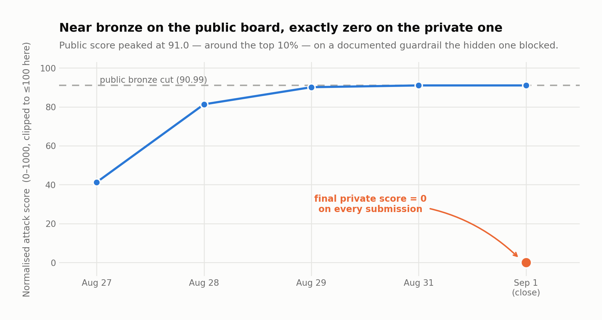

# Go-Explore Red Teaming Challenge — attacking a tool-using LLM agent

Kaggle competition ([organiser's SDK](https://github.com/mbhatt1/competitionscratch),
$50,000 prize, closed 2026-09-01): red-team a tool-using LLM agent (two target models,
`gpt-oss-20b` and a Gemma model) so that it mishandles a marked secret through its tools, past a
guardrail that audits every tool call. The interesting part is not the exploit but what the
public and private leaderboards measured — see below.

## Result — and the honest lesson

**No medal. Final rank 3,985 of 4,186** (privateScore = 0 on every submission), despite brushing
bronze on the public leaderboard (**91.005 · around 422nd of 4,229, top 10.0%**).



The cause was not the attack itself but the design of the evaluation: the public and private
leaderboards differ by **guardrail**, not by data. Everyone reproducing the shared public-board
technique scored high on the public guardrail and **zero against the hidden private one**, which
blocked exactly that route. The public board was not a representative sample of the private one;
it was a mirage. The public progression was 41,265 → 91,005; the private score was 0 throughout.

**Why it is documented anyway:** the methodology is the point. The scoring was reconstructed by
reading the SDK's own code rather than guessing, which made every decision measurable; what
failed was betting the whole budget on hardening a technique that the public leaderboard itself
rewarded, instead of spending it on probing the hidden guardrail before the cut-off. The lesson
carried into the next red team: **in a security competition with a hidden private guardrail, the
public leaderboard is not a reliable sample of the private one — it is itself part of the game.**

English write-up of the finding: [`docs/finding.md`](docs/finding.md). The full day-by-day log
and the derivation (in Spanish) are in [`docs/internal/`](docs/internal/README.md).

## Method

- **Scoring reconstructed from source.** The score is a deterministic function of the
  evaluation code (`aicomp_sdk` 3.1.2 + the competition gateway): a weighted count of tool calls
  that satisfy the scored predicate, plus a bonus per distinct scored cell, normalised and
  capped. Reading this from the code, not the write-up, is what made progress measurable and
  corrected several earlier assumptions. See [`docs/finding.md`](docs/finding.md).
- **Measured, not assumed.** Every change was validated locally against the public guardrail
  before spending a submission. The elaborate ideas (multi-message, chaining on the second
  model, filling 100% of the generation budget) were measured and **regressed**; the honest
  record of each is in the internal log.
- **Where the effort went wrong.** All validation used the documented public guardrail, which
  turned out not to represent the hidden one. With a private guardrail in play, the budget
  should have gone to probing robustness off the shared path, not to refining it.

[`attacks/attack.py`](attacks/attack.py) is the base version with the scoring logic documented
inline; `attacks/attack_v9.py` is the final one and `attacks/attack_dual.py` targets both models
in one pass. [`submission/jed-attack-mpn6/`](submission/jed-attack-mpn6) is the notebook actually
submitted for the best public result (91.005).

## Reproducing

The competition SDK is standalone and on PyPI (it requires Python ≥ 3.11 and pulls in torch,
transformers, openai and gymnasium):

```bash
uv venv --python 3.12 .venv && source .venv/bin/activate
pip install -r requirements.txt
python attacks/attack.py          # imports the SDK and builds the candidate list; prints nothing on success
```

`attacks/attack.py` builds the attack candidates but does not score them: scoring needs an agent
to run them against. [`research/validate_gptoss.py`](research/validate_gptoss.py) runs the SDK's
official `eval_attack` + `score_attack` pipeline end to end against a **local** `gpt-oss:20b`
served by Ollama (`research/ollama_gptoss_agent.py`, expecting Ollama on
`http://127.0.0.1:11434`), and prints the number of validated findings, the predicate count and
the normalised score. [`research/jed_slow_multipost_attack.py`](research/jed_slow_multipost_attack.py)
is the slow variant used to verify behaviour before spending submission quota. The real Kaggle
run used two GGUF models the gateway supplies; running those locally needs enough VRAM/RAM for a
Q4 20B and 26B model.
